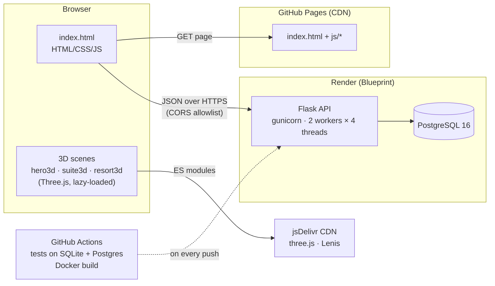
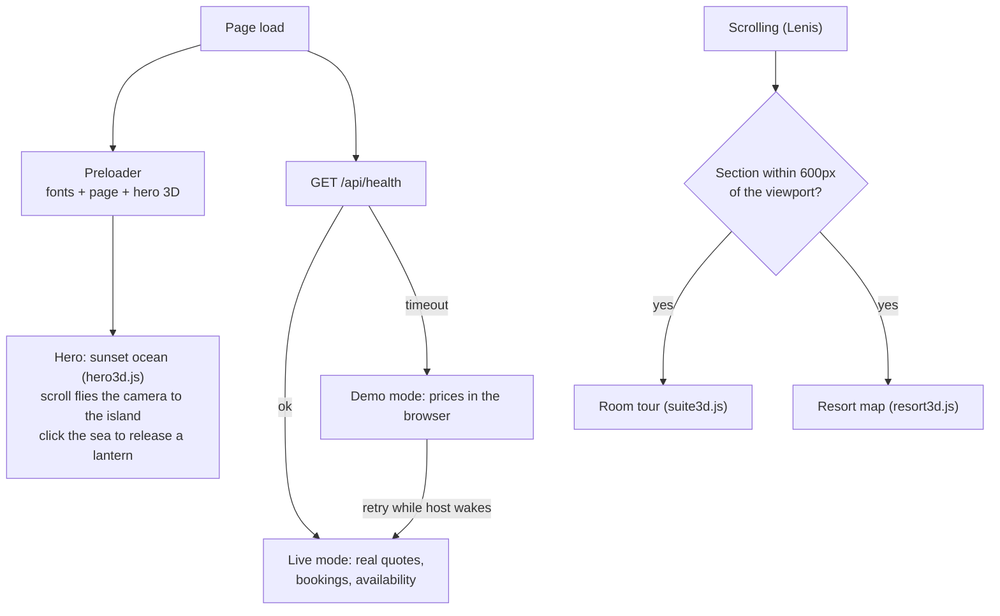
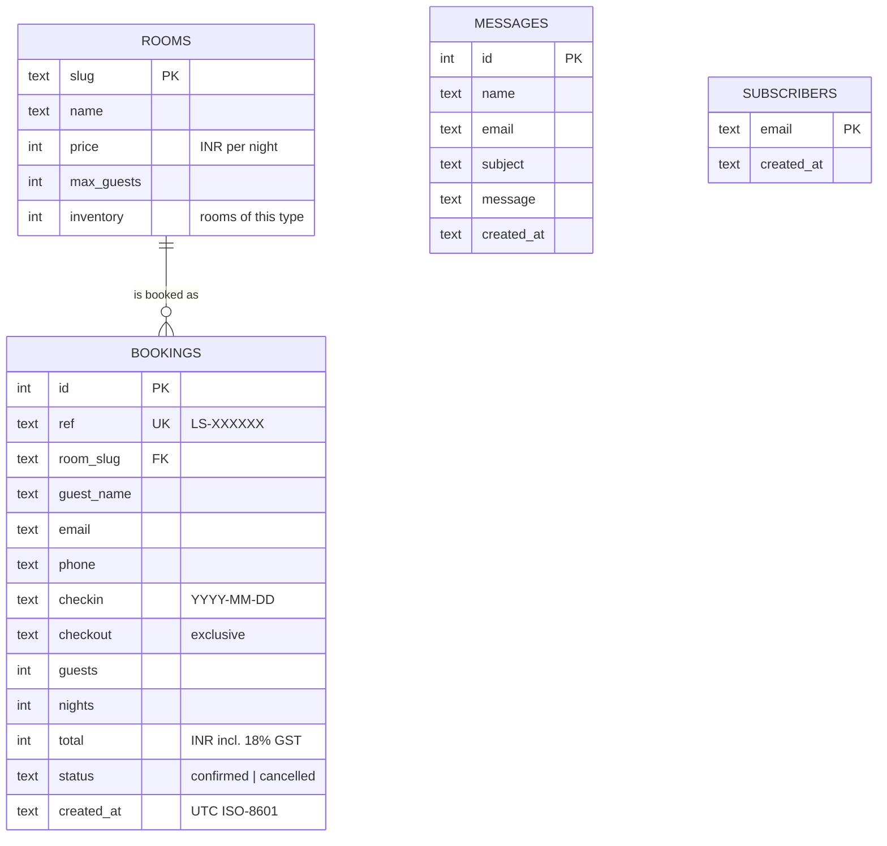
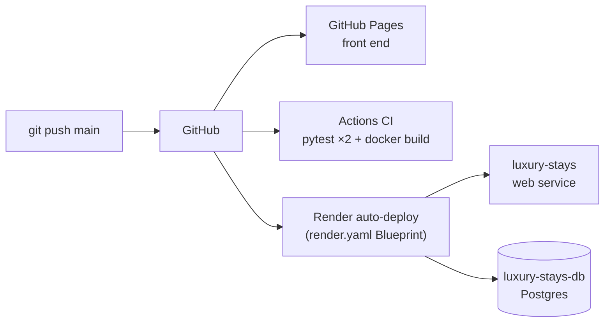

# Luxury Stays: System Design

Luxury Stays is a booking website for a fictional boutique resort. This document covers how it is built, why it is built that way, and how it would grow from one small server to real traffic.

- **Live site:** https://rounak251.github.io/hotelweb/
- **API docs:** `/api/docs` on the backend (Swagger UI, served from `/api/openapi.json`)

## 1. Requirements

**Functional**
- Guests can browse rooms in 3D, get a price quote, book a stay, look up a booking and cancel it.
- Each room type shows live availability for the next 14 nights.
- Staff can sign in to a dashboard to see bookings, occupancy and revenue, cancel bookings and export them as CSV.
- Contact messages and newsletter sign-ups are stored.

**Non-functional**
- **Correctness:** a room must never be double-booked, even when two guests book the last room at the same moment.
- **Availability:** the site must work without the backend. If the API can't be reached, it runs in demo mode with prices worked out in the browser.
- **Performance:** the 3D scenes must not slow the page down. Each loads only when it's about to come into view, renders only while visible, and falls back to photos on devices without WebGL 2.
- **Security:** validate all input, rate-limit write endpoints, and protect the admin area with a signed session cookie and CSRF tokens.
- **Cost:** it has to run on free tiers (GitHub Pages, Render).

## 2. Architecture



The front end and the API are deployed separately, so each can be cached, scaled and released on its own:

| Layer | Technology | Hosting | Notes |
|---|---|---|---|
| Front end | Plain HTML/CSS/JS, Three.js r170, Lenis | GitHub Pages | No build step; modules come from jsDelivr through an import map |
| API | Python 3.12, Flask 3, gunicorn | Render web service (or any Docker host) | Stateless apart from in-memory rate limits |
| Database | PostgreSQL 16 (prod), SQLite (local/tests) | Render managed Postgres | One SQL dialect via a thin adapter (`backend/db.py`) |
| CI | GitHub Actions | GitHub | pytest on SQLite and Postgres, plus `docker build` |

The backend can also serve the whole site itself (`GET /` and `/js/*`). In that case the page calls the API on the same origin and needs no CORS.

## 3. Front end



- **Progressive enhancement:** everything works as a normal page first. The 3D modules are dynamic `import()`s behind a WebGL 2 check, and each one adds an `is-3d` class only once it has rendered. Until then the photo stays.
- **Render budget:** each scene runs its `requestAnimationFrame` loop only while its section is on screen and the tab is visible (IntersectionObserver plus `visibilitychange`). With `prefers-reduced-motion` the scenes draw only on demand, and smooth scrolling, pins and the preloader are turned off.
- **Resort map (`js/resort3d.js`):** the island is procedural: an extruded shoreline, a terrain height function, instanced palms, bushes and lamps, and a custom water shader. The shader reads the shoreline from a 1-D texture to draw shallows and foam. Each of the seven places is a mesh group used for raycast picking. Its HTML pin is projected from 3D every frame and dimmed when the island hides it, which a throttled raycast checks. A time-of-day slider blends ten lighting keyframes for sky, sun or moon, water, window glow, lamps, stars and the lighthouse beam. Camera moves are timed fly-tos that interpolate in spherical coordinates. `camera.filmOffset` keeps the island centred in the space left of the info panel.
- **Booking UI:** it validates dates and guests in the browser and then asks the API for an authoritative quote. The API re-validates everything.

## 4. Data model



- **Inventory model:** each room type has an `inventory` count, for example 40 Deluxe rooms and 1 Presidential Suite. A stay is available when the confirmed bookings overlapping `[checkin, checkout)` number fewer than the inventory. The overlap test is `checkin < :checkout AND checkout > :checkin`.
- **Index:** `bookings(room_slug, checkin, checkout)` covers both the availability count and the calendar query.
- **Calendar:** `GET /api/rooms/<slug>/calendar` loads the bookings that overlap the requested window in one query. It then counts rooms left per night in Python, so the cost is O(bookings in the window + days) and there is no query per day.
- **Money:** amounts are stored as whole rupees in integers, so there are no float rounding errors. Tax is computed on the server and stored on the booking.
- **References:** booking references are random (`LS-` plus 6 hex characters from `secrets`), not sequential ids, so nobody can step through other guests' bookings. Lookups also need the guest's email.

## 5. API

| Method | Path | Purpose | Limit (per IP) |
|---|---|---|---|
| GET | `/api/health` | Liveness and database check (`503` when degraded) | none |
| GET | `/api/rooms` | Room types, prices and capacity | none |
| GET | `/api/rooms/<slug>/calendar?start=&days=` | Rooms left per night (1–90 days) | none |
| POST | `/api/availability` | Validate a stay and return a priced quote | 60/min |
| POST | `/api/bookings` | Create a booking (re-checks availability under a lock) | 10/min |
| GET | `/api/bookings/<ref>?email=` | Look up a booking | none |
| POST | `/api/bookings/<ref>/cancel` | Cancel a booking (email must match) | 10/min |
| POST | `/api/contact` | Store a contact message | 5/min |
| POST | `/api/subscribe` | Newsletter sign-up (idempotent) | 5/min |
| GET | `/api/openapi.json`, `/api/docs` | OpenAPI 3 spec and Swagger UI | none |
| GET/POST | `/admin`, `/admin/login`, `/admin/logout` | Staff dashboard and session | login 5/min, lockout after 5 failures |
| POST | `/admin/bookings/<ref>/cancel` | Cancel from the dashboard (CSRF token) | none |
| GET | `/admin/bookings.csv` | Export bookings | none |

Errors always come back as `{"error": "<message for the guest>"}` with a meaningful status: `400` for validation, `404` when something isn't found, `409` when a room is fully booked or a booking is already cancelled, and `429` for rate limits (with a `Retry-After` header).

## 6. Booking flow and double-booking protection

```mermaid
sequenceDiagram
  autonumber
  participant G as Guest's browser
  participant A as Flask API
  participant D as Postgres
  G->>A: POST /api/availability {room, dates, guests}
  A->>D: COUNT overlapping confirmed bookings
  A-->>G: quote {nights, subtotal, taxes, total, rooms_left}
  G->>A: POST /api/bookings {…quote fields, name, email}
  A->>D: BEGIN; SELECT … FROM rooms WHERE slug = ? FOR UPDATE
  Note over A,D: concurrent bookings of the same room type wait here
  A->>D: COUNT overlapping confirmed bookings (re-check)
  alt rooms left
    A->>D: INSERT booking; COMMIT
    A-->>G: 201 {ref: "LS-…", total, …}
  else sold out
    A->>D: ROLLBACK
    A-->>G: 409 "fully booked for those dates"
  end
```

Checking availability and inserting the booking are two separate statements. Without a lock, two requests for the last room could both pass the check before either one inserts. The API closes that race by serialising writers per room type:

- **Postgres:** `SELECT … FOR UPDATE` on the room type's row inside the transaction. Bookings for different room types don't block each other.
- **SQLite:** `BEGIN IMMEDIATE` takes the database write lock before the check.

The test suite proves this. Six threads try to book the only Presidential Suite for the same nights, and exactly one succeeds. The test runs on both databases in CI.

**Trade-off:** one lock per room type means bookings of the same type queue up for a few milliseconds. That's fine at hotel scale, where even a busy resort gets a handful of bookings per minute. Section 10 covers what changes for a large inventory.

## 7. Security

| Concern | Measure |
|---|---|
| Input | Every field is validated and length-limited on the server: email format, ISO dates, no past check-ins, 1–30 nights, guests within the room's capacity |
| SQL injection | Every query is parameterised; the adapter only rewrites placeholders (`?` → `%s`) |
| Abuse and brute force | Fixed-window rate limiter per IP and endpoint; admin lockout for 15 minutes after 5 failed logins; `ProxyFix` so the real client IP is used behind Render's proxy |
| Admin auth | Password from `ADMIN_TOKEN`, compared in constant time; signed session cookie (`SECRET_KEY`) that is `HttpOnly`, `SameSite=Lax` and `Secure`; 8-hour lifetime; CSRF token on every admin form |
| Cross-origin | CORS allowlist (`CORS_ORIGINS`), not `*` |
| Headers | `X-Content-Type-Options: nosniff`, `Referrer-Policy`, `Permissions-Policy`; `X-Frame-Options: DENY` and `Cache-Control: no-store` on admin |
| Output | Jinja auto-escaping in the dashboard; the front end escapes API data before inserting it into HTML; CSV cells starting with `= + - @` are prefixed so spreadsheet formulas can't run |
| Secrets | Only from environment variables; the Render Blueprint generates `ADMIN_TOKEN` and `SECRET_KEY` |
| Booking privacy | Unguessable references, and lookup needs the matching email |

## 8. Observability

- **Request logs:** one log line per request with method, path, status, latency and request id. The id comes from the incoming `X-Request-ID` if it's safe, otherwise it is generated, and it is echoed in the response header so a guest's error can be traced in the logs.
- **Health check:** `/api/health` runs `SELECT 1` against the database. Render, the Docker `HEALTHCHECK` and the front end's live/demo switch all use it.
- **Dashboard:** the admin page shows active bookings, booked revenue, occupancy for the next 14 nights and revenue by room type.

## 9. Deployment



| Environment | How |
|---|---|
| Local, quick | `python backend/app.py` uses SQLite and serves the whole site at `http://localhost:5000` |
| Local, production-like | `docker compose up --build` runs the API in the production image plus Postgres 16, at `http://localhost:8000` |
| Production | Render Blueprint (`render.yaml`): a web service plus managed Postgres, with secrets generated and health-checked deploys |
| Any container host | `Dockerfile` (python:3.12-slim, non-root, gunicorn, `HEALTHCHECK`) runs on Fly.io, Railway, Cloud Run or a VPS |

**Configuration** (12-factor; everything comes from the environment):

| Variable | Purpose | Default |
|---|---|---|
| `DATABASE_URL` | Postgres connection string (`postgres://` or `postgresql://`) | unset, so SQLite is used |
| `DATABASE_PATH` | SQLite file when `DATABASE_URL` is unset | `backend/hotel.db` |
| `ADMIN_TOKEN` | Admin password | `change-me` (logs a warning) |
| `SECRET_KEY` | Session signing key | random per process (logs a warning) |
| `CORS_ORIGINS` | Comma-separated allowed origins | `https://rounak251.github.io` |
| `RATELIMIT_ENABLED` | `0` disables rate limits | `1` |
| `SESSION_COOKIE_SECURE` | `0` allows the admin cookie over plain HTTP in local Docker | secure |
| `PORT` | Listen port | `5000` dev / `8000` Docker |

**Connecting the front end to the API:** set `BACKEND_URL` in `index.html` to the Render URL. The page checks `/api/health` with a 4-second timeout. If the free-tier instance is asleep, the page starts in demo mode, keeps retrying for up to two minutes, and switches to live bookings once the API answers.

## 10. Scaling plan

Rough sizing: 83 rooms, a few thousand visitors a day, and fewer than 100 bookings a day. Traffic is almost all reads (page, rooms, calendar). One small instance handles this easily. If it had to grow, these are the steps in order:

1. **Scale the API horizontally.** The app is stateless except for the in-memory rate limiter and login throttle. Move those to Redis (`INCR` plus `EXPIRE` per key) so limits hold across instances, then put N instances behind the load balancer.
2. **Pool database connections.** Use PgBouncer in transaction mode in front of Postgres; today each request opens one connection.
3. **Cache reads.** `/api/rooms` rarely changes, so cache it at the CDN for minutes. Cache calendar responses in Redis with a TTL of a few seconds, and invalidate a room type's keys when one of its bookings changes. Availability is always re-checked under the lock at booking time, so a slightly stale calendar can never cause an oversell.
4. **Use per-night inventory for large hotels.** Replace "count overlapping bookings" with a `room_nights(room_slug, night, booked)` table. Book with `UPDATE room_nights SET booked = booked + 1 WHERE room_slug = ? AND night BETWEEN ? AND ? AND booked < inventory`, and check that the number of rows updated equals the number of nights. This locks only the nights involved, so bookings for different dates no longer wait on each other.
5. **Add payments with idempotency.** Take payment with Razorpay or Stripe, sending an idempotency key per booking attempt. Keep a `pending_payment` state with a hold that expires, and confirm the booking from the payment webhook.
6. **Run side effects asynchronously.** Confirmation emails, the newsletter and CSV exports go through an outbox table that a worker drains. Then a slow mail provider can never fail a booking.
7. **Add read replicas.** Point dashboard reports and exports at a replica so they don't compete with bookings.
8. **Improve observability.** Ship structured JSON logs to a log store, track RED metrics (rate, errors, duration) per endpoint, and alert on 5xx rates and slow booking latency.

## 11. Trade-offs and known limits

- **Free-tier hosting:** the Render web service sleeps after about 15 minutes idle (the first request then takes up to a minute), and Render's free Postgres expires after 30 days. The front end handles the cold start; for anything real, use a paid instance and database.
- **Per-process rate limits:** with 2 gunicorn workers the effective limit is about 2× the configured one. This is acceptable for a demo; step 1 above fixes it.
- **Dates as ISO text:** dates are stored as `YYYY-MM-DD` strings, which sort and compare correctly in both SQLite and Postgres. Native `DATE` columns would be the next schema change.
- **One server-side "today":** "no past check-ins" and the calendar start use the server's date (UTC on Render). Near midnight, IST is up to 5.5 hours ahead of UTC.
- **3D on low-end phones:** shadows, pixel ratio and particle counts drop on small screens, and touch devices use buttons instead of one-finger drag so page scrolling isn't hijacked. Very old GPUs get the photo fallback.

## 12. Repository map

```
index.html            page, styles and UI logic (no build step)
js/hero3d.js          sunset ocean hero, scroll-driven camera, click-to-release lanterns
js/suite3d.js         3D room tour (four room types, day/night)
js/resort3d.js        3D resort map: places, time of day, fly-to camera, picking
backend/app.py        Flask app: config, middleware, public API
backend/db.py         SQLite/Postgres adapter, schema, per-room-type write lock
backend/security.py   rate limiter, login throttle, security headers
backend/admin.py      admin login, dashboard, cancel, CSV export
backend/openapi.py    OpenAPI 3 spec and Swagger UI page
backend/test_app.py   35 tests (run on SQLite and Postgres in CI)
Dockerfile            production image (gunicorn, non-root, health check)
docker-compose.yml    API + Postgres for local development
render.yaml           Render Blueprint: web service + Postgres
.github/workflows/    CI
```
